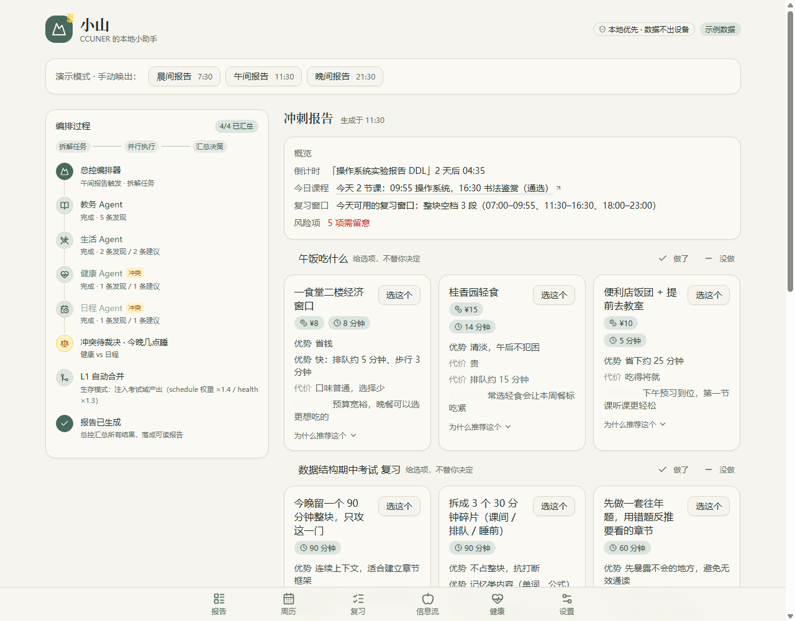
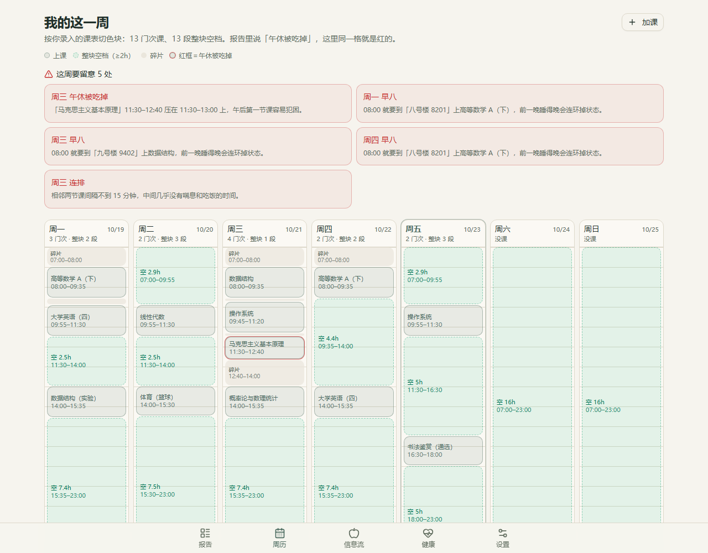
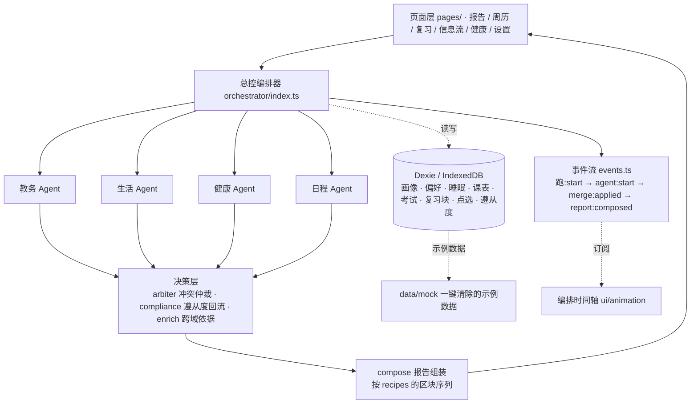

# 小山 · CCUNER 的本地小助手

专属于华师（CCNU）学生的本地优先 AI 校园助手：**数据不出设备，决策过程看得见。**

> 校园黑客松参赛项目 🏔️🌼

**[打开在线 Demo](https://swift-aurora-e8ai1hx.tmp.now)** · Vercel 部署，无需账号，数据只保存在当前浏览器。

## 为什么是小山

- **本校专属**：只做华师（桂子山 / 南湖），信息按身份过滤，山民秒懂
- **本地优先**：课表、日程、健康数据只存在你自己的设备上，断网照样用
- **可解释多智能体**：教务 / 生活 / 健康 / 日程 4 个专职 Agent + 总控编排器，每条建议都给出依据
- **给选项，不替人决定**：所有建议以选项卡呈现，标注成本与可能影响，用户拍板，助手记住偏好

## 功能一览





| 页面 | 路由 | 做什么 |
|---|---|---|
| 报告 | `/` | 三段式报告（晨间 7:30 / 午间 11:30 / 晚间 21:30），左侧实时编排时间轴；进考试周自动变「冲刺报告」 |
| 周历 | `/week` | 一周课表色块 + 风险卡（早八 / 连排 / 午休被吃掉）；**点课程看详情、改、删；点空白加课；拖拽换时段** |
| 复习 | `/plan` | 按考试自动排复习草案（掌握度低的优先），**拖动互换时段、勾选做完**，落 IndexedDB |
| 信息流 | `/feed` | 教务 / 快递 / 食堂混排，每条标注「为什么推给我」，可收藏、可「与我无关」 |
| 健康 | `/health` | 睡眠手动录入 + 近 7 天柱图 + 精力估算（明确标注是估算） |
| 设置 | `/settings` | Agent 逐个启停、外观切换、强制关闭生存模式、改画像、清除数据 |
| 建档 | 首屏闸门 | 新用户 30 秒七屏：隐私承诺 → 身份 → 身体基线（可跳过）→ 课表 → 餐标 → 偏好三题 → 画像卡 |

## 核心机制

1. **契约驱动**：`src/types/contract.ts` 是 Agent 契约的**唯一代码实现**，与 `docs/agent-contract.md` 逐条对应（当前 v1.4）。新增报告类型时，`ReportType` / `RECIPES` / `SLOT_OF` / `REPORT_TITLE` 四处的 `Record` 会让 TypeScript 直接报错，漏改编不过。
2. **冲突仲裁**：Agent 各自独立产出「主张」，同主题 ≥2 个主张才交给仲裁器——可合并的走 **L1 自动合并**（如「午间小憩」+「取快递」），不可合并的走 **L2 冲突卡**（如「考前一晚按计划睡」vs「再看 1 小时」，两边代价都写清）。
3. **生存模式**：考前 7 天内自动进 exam 模式，报告切成「冲刺报告」（倒计时 / 复习窗口 / 掌握度分档），日程与健康 Agent 权重上浮；考完 2–6 小时出「考后小结」；设置页有「强制关闭生存模式」开关兜底。
4. **遵从度回流**：晚间点「做了 / 没做」会落库；同一主题**连续 2 次没做**，下次该建议的 priority 自动降一级，并在编排时间轴上说明原因；周报显示本周执行率。
5. **离线可用**：`vite-plugin-pwa` + workbox 预缓存，`navigateFallback` 让 `/week`、`/plan` 等子路由断网也能打开。

## 架构



```
src/
  types/contract.ts       # Agent 契约唯一实现（对应 docs/agent-contract.md）
  agents/                 # 教务 / 生活 / 健康 / 日程 4 个专职 Agent + registry
  orchestrator/
    index.ts              # 总控：取数 → 并行跑 Agent → 决策 → 组装
    arbiter.ts            # 冲突仲裁：L1 自动合并 / L2 冲突卡
    compliance.ts         # 遵从度回流：连续没做 → 降 priority；周报执行率
    exam.ts               # 生存模式注入：倒计时 / 复习窗口 / 考前夜 / 考后小结
    enrich.ts             # 跨域依据挂载（午饭 × 健康 × 日程）
    recipes.ts            # 每种报告类型的区块序列
    compose.ts            # 按配方组装 Report
    events.ts             # 编排事件流
  data/
    adapters/             # 数据源 adapter（mock 与真实源同一接口）
    store/                # Dexie：db / profile / courses / review / feed / boot
    relevance.ts          # 信息流相关性打分 + 「为什么推给我」理由
    queries.ts            # 课表、时间块、睡眠统计等派生计算
    mock/                 # 示例数据集中管理
  lib/
    examMode.ts           # 考试窗口判定（7 天 / 考后 2–6 小时）
    reportSlot.ts         # 当前时段与报告槽位
    theme.ts              # 暗色跟随系统
  ui/
    reports/              # 报告区块渲染器（overview / suggestionGroup / conflict / warning / recap / preview / checklist）
    cards/                # 选项卡 / 冲突卡
    week/CourseSheet.tsx  # 看课 / 改课 / 加课面板
    animation/            # 编排事件流可视化
  pages/                  # Home / Week / Plan / Feed / Health / Settings / Onboarding
  App.tsx                 # 路由 + 底部导航 + 建档闸门
```

## 文档导航

- [项目设计文档](docs/CCUNER校园助手-项目设计.md) —— 产品定位、功能详设、多智能体架构与冲突仲裁、考试周生存模式、onboarding、隐私设计、品牌视觉、路演脚本
- [Agent 契约](docs/agent-contract.md) —— 类型、事件、区块、生存模式与遵从度回流（**v1.4**，改 Agent 或报告前必读）
- [开发任务清单](docs/dev-tasks.md) —— A/B 分工、完成度、当前剩余
- [部署说明](docs/deploy.md) —— 静态部署步骤、部署后验收、断网彩排

## 技术栈

React 19 + TypeScript + Vite · Tailwind CSS + shadcn/ui · Dexie / IndexedDB（本地数据层） · recharts（趋势图） · vite-plugin-pwa（离线可用）

## 快速开始

```bash
npm install
npm run dev      # http://localhost:3000
npm run build    # tsc -b && vite build，产物 dist/（含 Service Worker）
npm run preview  # 以产物方式起服务，断网演示要用这个，不要用 dev
```

首屏自动唤出当前时段的报告：左侧是「总控编排器 → 4 个专职 Agent」的实时编排事件流，右侧是报告卡（选项卡 / 冲突卡 / 依据展开）。顶部三个按钮可手动唤出晨间 / 午间 / 晚间报告。

### 演示与离线

- **示例数据**：首次打开写的是带「示例数据」徽标的示例课表与通知，设置页可一键清除；清除后刷新会走一遍 30 秒建档。
- **断网演示**：`npm run dev` 下 Service Worker 不注册，**必须** `npm run build && npm run preview`，首屏加载一次后直接断网（或关掉 preview 进程）刷新，页面照常打开。
- **演示开关**：设置页「强制关闭生存模式」可随时退出考试周形态；「恢复示例数据」清空后重新播种。

## 隐私

所有数据落在浏览器 IndexedDB，无后端、无账号、无上行请求；示例数据带标签可一键清除；健康数据只记睡眠时长与入睡时间，注明「精力线是按时长推算的估算值，不是实测」。

## 协同开发

见设计文档 §14。要点：`main` 受保护，`feat/*` / `fix/*` 分支经 PR 合并；约定式提交；mock 数据集中管理，UI 只走 adapter 层与契约 Schema。

## 当前状态

**已完成**：契约 v1.4、编排器 + 冲突仲裁（L1/L2）、4 个专职 Agent、本地数据层（Dexie v4）、三段式报告、生存模式（冲刺报告 / 考后小结）、遵从度回流、信息流相关性、30 秒建档、周历看课改课加课、复习计划草案与拖拽、健康睡眠录入与趋势、暗色模式、手机端适配（375px）、离线可用、Vercel 在线 Demo。代码规范检查 0 错误，正式构建通过。

**未完成**：3 分钟路演视频、一页项目介绍；iPhone 真机与微信内置浏览器的实测只能人工确认。
