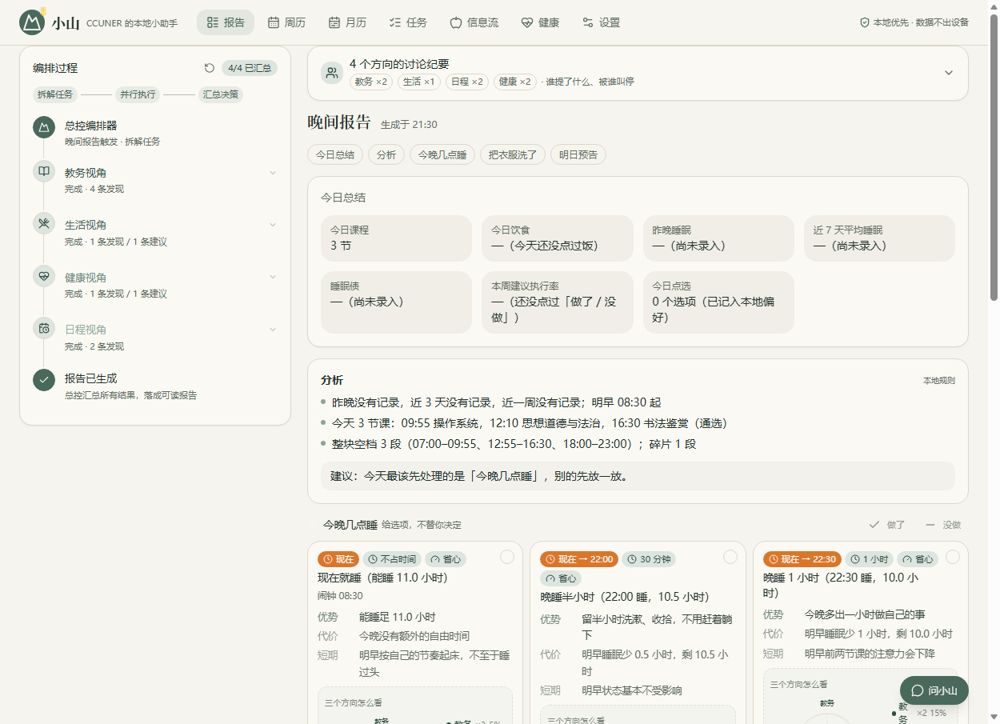
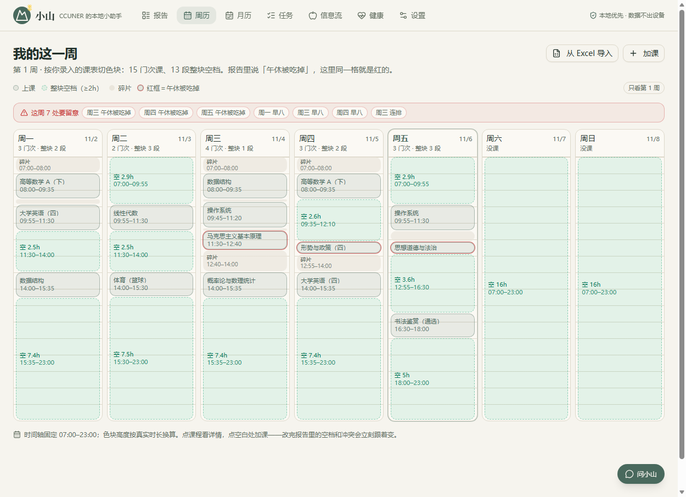
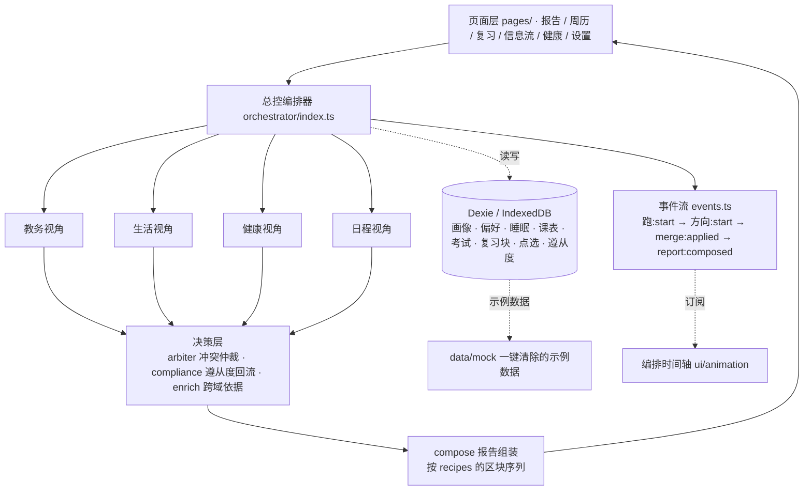

# 小山 · CCUNER 的小助手

面向华中师范大学（桂子山 / 南湖）学生的本地优先校园助手：**数据在本机处理，决策过程看得见。**

**[打开在线站点](https://king-getting.github.io/no-sleep-/)** · GitHub Pages 托管，push 到 `main` 自动构建，无需账号，数据只保存在当前浏览器。
**[Android 安装包](https://github.com/king-getting/no-sleep-/releases)** · 侧载 APK，全屏独立应用，数据在 App 内。
**[Vercel 备份站](https://ccuner-xiaoshan.vercel.app)** · 连接 GitHub 自动部署；`*.vercel.app` 在国内多地会被 DNS 投毒 + TLS 重置，打不开就忽略。

## 为什么是小山

- **本地优先的数据处理**：课表、日程、健康数据都在这台设备上处理与保存，断网照样能用
- **多个思考方向**：从教务 / 生活 / 健康 / 日程几个方向分别想一遍再汇总，每条建议都给出依据；思考过程可以接入 API（大模型）来做
- **给建议，不替人决定**：建议里写明成本与可能影响，最终由你拍板，助手记住你的偏好
- **结论可追溯**：每条结论都挂得住原始事实（哪节课、哪晚睡眠、哪场考试），点开就能看依据——不是「AI 想了想」

> 适用范围：华中师范大学在校学生（桂子山 / 南湖校区）。这不是产品特色，只是目前只接了这所学校的数据源。

## 特点（创新点）

| # | 创新点 | 对应的实现 |
|---|---|---|
| 1 | **多方向思考，结论可追溯** | 报告页左侧展示「拆任务 → 各方向分别分析 → 冲突检出 → 汇总成卡」的过程，每条结论都带依据；思考层可换成大模型 API |
| 2 | **本地优先（Local-first）** | 断网可用：关掉网络刷新页面，功能照常；所有个人数据只在浏览器 IndexedDB |
| 3 | **建议 = 决策支持** | 每条建议写明「优势 / 代价 / 可能影响」（短期与长期），把取舍摊开，决定权仍在用户 |
| 4 | **冲突显性化，仲裁权归用户** | 各方向意见打架时不做折中黑盒：L1 可调和的自动合并并说明，L2 真冲突弹出冲突卡，两边代价写清，用户二选一，系统记住裁决偏好 |
| 5 | **上下文感知的考试周** | 考前 7 天，日程与健康权重上浮、复习建议按掌握度分档，概览顶部加一条倒计时；报告本身仍按当前时段出，不会整天只剩「冲刺」 | |

## 效果展示





### 实例 1：午间报告（11:30 定时生成）

打开首页即见。左侧时间线依次出现：总控编排器拆任务 → 教务 / 生活 / 健康 / 日程 4 个方向并行分析 → 汇总成卡；下方是**风险面板**。右栏顶部是**讨论纪要**：谁提了什么、被谁叫停、谁被合并、权重怎么变。报告卡给出「午饭吃什么」三张选项卡，每张标注价格、时间、优势、代价与可能影响；选项卡底部还有**其他方向怎么看**——各方给出「认可一点 / 不放心一点」，并按影响强度排出「影响最大 / 最小」。

### 实例 2：L2 冲突卡（方向打架）

当今晚存在 ≥2h 整块空档、48h 内有 DDL、且近三天缺觉时，日程视角（排复习）与健康视角（提前睡）的主张在仲裁器里撞成真冲突，报告里弹出冲突卡：方案 A「留 90 分钟整块复习」、方案 B「现在就准备睡」，两边的优势、代价、短期/长期影响都写清。用户裁决一次后，同类冲突下次自动预填上次选择，不再重复打扰。

### 实例 3：断网可用

```bash
npm run build && npm run preview   # 注意：dev 模式不注册 Service Worker
```

首屏加载一次后，直接断网（或杀掉 preview 进程）再刷新，`/`、`/week`、`/plan`、`/feed` 等全部路由照常打开——PWA 预缓存 + `navigateFallback` 兜底。

### 实例 4：课表 Excel 导入

周历页（`/week`）右上角「从 Excel 导入」，两种表都能读：

- **教务系统导出的网格课表**：星期做列头、节次做行首，直接选文件即可；合并单元格会展开成真实时长（连上两节 = 08:00–11:50）
- **自己整理的表**：第一行表头「课程名 / 星期 / 开始 / 结束」（可选 教师 / 地点 / 周次）

周次支持 `1-16`、`1,3,5,7`、`2-16双`；错误行带行号提示，不阻断有效行。

### 实例 5：月历与教学周

`/month` 铺真实日历，标今天与「第 N 周」。单双周课程只在对应周出现；学期第一周设错时，周历会直接说明「第 N 周按课表没有课」，并给「显示全部课程」和「去改学期第一周」两个出口。

### 实例 6：习惯测评 → 排期

`/assessment` 12 题（节奏 / 计划 / 专注 / 推进），产出画像外号与四个参数；复习排期直接用这些参数：单块 30/60/90 分钟、提前 3–7 天、每日配额、优先上午或晚上。

### 实例 7：今日简报

首页底部的简报由**事实包**生成：每条结论挂 `factIds`，点「依据」展开它引用的原始事实（哪节课、哪晚睡眠、哪场考试）。校验不过的内容不会上屏。

## 功能一览

| 页面 | 路由 | 做什么 |
|---|---|---|
| 报告 | `/` | 按当前时段出报告（晨间 7:30 / 午间 11:30 / 晚间 21:30）；概览 → **分析**（多角度判断 + 一句建议）→ 建议卡（含跨方向雷达）→ 风险项；考试周只在概览加一条倒计时 |
| 今日简报 | 首页底部 | 由本地事实包生成，每条结论可展开「依据」；引用校验不过就整段回落模板 |
| 周历 | `/week` | 一周课表色块 + 风险提示；点课程改删、点空白加课、拖拽换时段、Excel 导入；按教学周过滤，可一键显示全部 |
| 月历 | `/month` | 真实月历，标今天与「第 N 周」；单双周课程按周次出现；点某天看当天课表；学期第一周可改；**纪念日**栏（生日 / 在一起的日子） |
| 任务 | `/plan` | 考试 / DDL 与 1–5 级掌握度；按考试重排草案，拖动互换时段、勾选完成 |
| 信息流 | `/feed` | 华师真实通知快照（本科生院 / 学校官网 / 校团委 / 后勤保障部），带发布单位、日期与原文链接；校医院 / 图书馆 / 报修入口；时间 × 类型 × 相关度筛选 |
| 健康 | `/health` | 睡眠手动录入 + 近 7 晚柱图 + 睡眠债 / 入睡波动；按当天点选的饭生成饮食总结；晚间出「今晚几点睡」三档 |
| 测评 | `/assessment` | 12 题任务习惯测评，产出四个参数（单块时长 / 提前天数 / 每日配额 / 优先时段），直接进复习排期 |
| 设置 | `/settings` | 方向启停与权重、外观、模型接入、画像、安装与自动备份、数据导出 / 导入 |
| 建档 | 首屏闸门 | 隐私承诺 → 身份 → 身体基线（可跳过）→ 课表（示例 / 空表 / Excel）→ 餐标 → 偏好三题 → 画像确认 → 可选测评 |

## 模型能做什么（可选）

不填 Key 时全部走本地规则与模板，联网请求为零；填了 Key（设置 → 模型接入，支持 DeepSeek / OpenAI / 通义千问 / Kimi）后，模型做三件事，每件都有本地边界兜底：

| 层次 | 模型负责 | 本地负责 |
|---|---|---|
| 对话改数据 | 理解「把周三的高数改到周四 10 点」并调用工具 | 工具真正读写 IndexedDB；撞课、越界由工具拒绝 |
| 写简报 / 分析 / 预报 | 把事实串成多角度的判断与建议 | 数字、日期、统计；引用不存在或超长整段回落模板 |
| 在边界内排方案 | 排「今晚几点睡」这类 2–3 档取舍 | 几点起、能睡几小时、最多拖 90 分钟；越界 / 少于两档 / 只剩不到 3 小时一律判失败 |

硬约束写在代码里，不只是提示词：简报每条要挂真实 `factIds`，分析至少覆盖 2 个方向，方案必须包含「现在就睡」且至少一档往后挪，任何一条不过就回落到本地版本。

## 核心机制

1. **契约驱动**：`src/types/contract.ts` 是报告契约的**唯一代码实现**，与 `docs/report-contract.md` 逐条对应（当前 v1.4）。新增报告类型时，`ReportType` / `RECIPES` / `SLOT_OF` / `REPORT_TITLE` 四处的 `Record` 会让 TypeScript 直接报错，漏改编不过。
2. **冲突仲裁**：每个方向独立产出「主张」，同主题 ≥2 个主张才交给仲裁器——可合并的走 **L1 自动合并**（如「午间小憩」+「取快递」），不可合并的走 **L2 冲突卡**（如「考前一晚按计划睡」vs「再看 1 小时」，两边代价都写清）。
3. **考试周**：考前 7 天内自动进 exam 模式——日程与健康权重上浮、按掌握度给复习路径、概览顶部加倒计时；报告类型仍跟随当前时段（晨 / 午 / 晚），不会整天只剩冲刺内容；考完 2–6 小时出「考后小结」。
4. **遵从度回流**：晚间点「做了 / 没做」会落库；同一主题**连续 2 次没做**，下次该建议的 priority 自动降一级，并在编排时间轴上说明原因；晚报显示本周执行率（没记录就显示「—」，不编数字）。
5. **离线可用**：`vite-plugin-pwa` + workbox 预缓存，`navigateFallback` 让 `/week`、`/plan` 等子路由断网也能打开。
6. **方向即插即用**：统一 `DirectionModule` 接口 + 注册表，新增一个思考方向 = 加一个文件 + 注册一行；设置里按方向启停即改 `enabled` 字段。
7. **事实包 → 简报**：`lib/facts.ts` 把本地数据折成带稳定 id 的事实，`lib/brief.ts` 生成结构化结论（每条挂 `factIds`），上屏前 `validateBrief` 校验引用是否真实存在、字段是否超长，**任何一条不过就整段回落模板**。生成器是 adapter：设置页填 OpenAI 兼容地址 / 模型 / key 后即可切到模型，默认关闭；失败或校验不过整段回落模板。
8. **教学周**：课程带 `weeks`（如 `[1,3,5]`），学期第一周存 `semesterStart`；周历、月历、复习排期都用它换算「这周到底上不上」，学期设错时周历会明确提示并给一键显示全部。

## 架构



```
src/
  types/contract.ts       # 报告契约唯一实现（对应 docs/report-contract.md）
  directions/                 # 教务 / 生活 / 健康 / 日程 4 个思考方向 + registry
  orchestrator/
    index.ts              # 总控：取数 → 并行跑各方向 → 决策 → 组装
    arbiter.ts            # 冲突仲裁：L1 自动合并 / L2 冲突卡
    compliance.ts         # 遵从度回流：连续没做 → 降 priority；周报执行率
    exam.ts               # 生存模式注入：倒计时 / 复习窗口 / 考前夜 / 考后小结
    enrich.ts             # 跨域依据挂载（午饭 × 健康 × 日程）
    recipes.ts            # 每种报告类型的区块序列
    compose.ts            # 按配方组装 Report
    reviews.ts            # 跨方向评审：每条建议对各方的影响强度
    events.ts             # 编排事件流
  data/
    adapters/             # 数据源 adapter（mock 与真实源同一接口）
    store/                # Dexie：db / profile / courses / review / feed / backup / boot
    relevance.ts          # 信息流相关性打分 + 「为什么推给我」理由
    queries.ts            # 课表、时间块、睡眠统计等派生计算
    mock/                 # 示例数据与华师真实通知快照（ccnu / services）
  lib/
    facts.ts              # 事实包：带 id / 来源的本地事实
    brief.ts              # 简报生成 + 引用校验 + 模板兜底（生成器可换模型）
    weeks.ts              # 教学周解析与日期换算
    assessment.ts         # 12 题测评：题目、计分、四维画像、排期参数
    courseExcel.ts        # 课表 Excel 解析（平表 + 教务网格表 / 行级报错 / 去重）
    outlook.ts            # 未来两天 / 下周 / 本周总结的纯计算
    examMode.ts           # 考试窗口判定（7 天 / 考后 2–6 小时）
    reportSlot.ts         # 当前时段与报告槽位
    theme.ts              # 暗色跟随系统
  ui/
    reports/              # 报告区块渲染器 + 讨论纪要（DebatePanel）+ 风险面板
    cards/                # 选项卡（含跨方向评审）/ 冲突卡
    brief/                # 今日简报卡
    outlook/              # 未来两天 / 下周预报 / 本周总结
    week/                 # 看课/改课/加课面板 + Excel 导入组件
    animation/            # 编排事件流可视化
  pages/                  # Home / Week / Month / Plan / Feed / Health / Assessment / Settings / Onboarding
  App.tsx                 # 路由 + 底部导航 + 建档闸门
```

## 运行教程

### 环境要求

- Node.js ≥ 20（开发用的是 Node 24，Vite 7 需要较新版本）
- 无需任何后端、数据库或账号；所有数据在浏览器 IndexedDB 里

### 1. 本地运行（开发）

```bash
git clone https://github.com/king-getting/no-sleep-.git
cd no-sleep-
npm install
npm run dev        # http://localhost:3000
```

### 2. 生产构建与离线验证

```bash
npm run build      # tsc -b && vite build，产物 dist/（含 Service Worker）
npm run preview    # 以产物方式起服务——验证离线必须用这个，dev 模式 SW 不注册
```

断网彩排：preview 起来后打开一次首页 → 断网（或杀进程）→ 刷新，各路由照常。

### 3. 体验完整功能（示例数据）

首次打开会自动灌入带「示例数据」徽标的示例课表 / 考试 / 通知 / 睡眠：

- 顶部按钮可手动唤出晨间（7:30）/ 午间（11:30）/ 晚间（21:30）任意时段报告
- 示例考试自动排在未来 12 天，用来验证生存模式、冲刺报告与考后小结的切换
- 设置页可「清除数据」（走一遍 30 秒建档）或「恢复示例数据」

### 4. 录入自己的数据

- **课表**：周历页点空白加课 / 点课程改删 / 拖拽换时段，或「从 Excel 导入」（[模板](docs/assets/课表导入模板.xlsx)）
- **考试 / DDL**：任务页（`/plan`）新增，可设 1–5 级掌握度；考前 7 天会按掌握度给复习路径，并在报告概览顶部显示倒计时
- **睡眠**：健康页（`/health`）手动录入，报告里的精力估算随之变化

### 5. 部署

- **Vercel**：导入 GitHub 仓库即自动部署，`vercel.json` 已配好 SPA 路由回写；push 到 `main` 自动更新
- **Netlify 镜像**（备用，账号额度恢复后可用）：`npm run build` 后 `npx netlify-cli deploy --dir=dist --prod`

## 测试与验证状态

- `npm run lint`：0 错误；`npm run build`：通过
- 断网彩排通过（build + preview 下关网刷新，三路由正常）
- 课表 Excel 解析经模板文件 + 边界数据（空行 / 错行 / 中文星期 / Excel 时间序列值 / 重复行）实测

## 隐私

所有数据落在浏览器 IndexedDB，没有后端、没有账号。默认不发任何网络请求——断网也能用。

如果自己在设置里填了模型 Key，只有这三类内容会发给你选的服务商：事实清单（课程名、地点、睡眠时长、考试名、周统计）、画像摘要（年级 / 学院）、你输入的那句话。**Key 只存在本机 localStorage**，不经过任何中转。随时可以在设置里关掉模型或清除全部本机数据。

健康数据只记睡眠时长与入睡时间，界面注明「精力线是按时长推算的估算值，不是实测」。

## 已知边界与后续路线

- **通知是真的，教务课表靠导入**：信息流每日从本科生院抓取并提交，App 打开时拉取；课表目前靠 Excel 导入或手动录入，教务系统只留了 `TimetableAdapter` 接口（没有公开 API，需要登录态）
- **食堂 / 天气仍是示例数据**：全部走 adapter 接口层，换真实源只需实现同一接口
- **模型不决定事实**：所有数字由本地算，模型只做取舍和措辞；不填 Key 时没有任何外部调用
- 碎片时间阈值当前实现为 <2h（设计文档早期版本写作 <45min，以契约为准）
- 后续路线：真实教务 / 素拓对接、生涯规划与财务方向、校园众测数据源（食堂人流、课程评价）

## 文档导航

- [项目设计文档](docs/CCUNER校园助手-项目设计.md) —— 产品定位、功能详设、多方向架构与冲突仲裁、考试周生存模式、onboarding、隐私设计、品牌视觉
- [报告契约](docs/report-contract.md) —— 类型、事件、区块、生存模式与遵从度回流（v1.4，改报告前必读）
- [开发任务清单](docs/dev-tasks.md) —— A/B 分工与完成度
- [部署说明](docs/deploy.md) —— 静态部署步骤、部署后验收、断网彩排
- [课表导入模板](docs/assets/课表导入模板.xlsx) —— 填好即导

## 技术栈

React 19 + TypeScript + Vite · Tailwind CSS + shadcn/ui · Dexie / IndexedDB（本地数据层） · recharts（趋势图） · xlsx（课表导入） · vite-plugin-pwa（离线可用）
