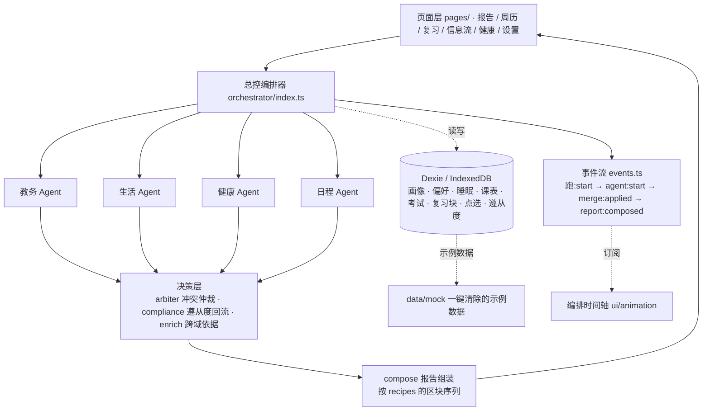

# 小山 · CCUNER 的本地小助手

专属于华师（CCNU）学生的本地优先 AI 校园助手：**数据不出设备，决策过程看得见。**

**[打开在线 Demo（国内镜像）](https://ccuner-xiaoshan-mirror.netlify.app)** · Netlify 托管，无需账号，数据只保存在当前浏览器。
**[Vercel 主站](https://ccuner-xiaoshan.vercel.app)** · 连接 GitHub，push 到 `main` 自动部署最新版；部分网络环境可能无法访问，请优先使用上方镜像。

## 为什么是小山

- **本校专属**：只做华师（桂子山 / 南湖），信息按身份过滤
- **本地优先**：课表、日程、健康数据只存在你自己的设备上，断网照样用
- **可解释多智能体**：教务 / 生活 / 健康 / 日程 4 个专职 Agent + 总控编排器，每条建议都给出依据
- **给选项，不替人决定**：所有建议以选项卡呈现，标注成本与可能影响，用户拍板，助手记住偏好

## 特点（创新点）

| # | 创新点 | 现场可见的证据 |
|---|---|---|
| 1 | **可解释的多智能体编排** | 报告页左侧实时展示「总控拆任务 → 4 Agent 并行 → 冲突检出 → 汇总成卡」的编排事件流，每个 Agent 的结论都带依据 |
| 2 | **本地优先（Local-first）** | 断网演示：关掉网络刷新页面，功能照常；所有个人数据只在浏览器 IndexedDB |
| 3 | **选项卡 = 决策模拟** | 每条建议 2–3 张选项卡，标注「优势 / 代价 / 可能影响」（短期与长期），降解决策成本而不是替人决策 |
| 4 | **冲突显性化，仲裁权归用户** | Agent 打架时不做折中黑盒：L1 可调和的自动合并并说明，L2 真冲突弹出冲突卡，两边代价写清，用户二选一，系统记住裁决偏好 |
| 5 | **上下文感知的生存模式** | 考前 7 天自动切换「冲刺报告」，同一数据「昨晚睡 5.5h」平时是小憩建议、考前夜是红线警告——Agent 权重随场景变化 |

## 效果展示


### 实例 1：午间报告（11:30 定时生成）

打开首页即见。左侧时间线依次出现：总控编排器拆任务 → 教务 / 生活 / 健康 / 日程 4 个 Agent 并行执行 → 汇总成卡。右侧报告卡给出「午饭吃什么」三张选项卡，每张标注价格、时间、优势、代价与可能影响，点「为什么」可展开各 Agent 的依据（如「生活 Agent：该窗口 12:10 前为低峰」「健康 Agent：你昨晚睡 5.5h，清淡饮食午后不犯困」）。

### 实例 2：L2 冲突卡（Agent 打架）

当今晚存在 ≥2h 整块空档、48h 内有 DDL、且近三天缺觉时，日程 Agent（排复习）与健康 Agent（提前睡）的主张在仲裁器里撞成真冲突，报告里弹出冲突卡：方案 A「留 90 分钟整块复习」、方案 B「现在就准备睡」，两边的优势、代价、短期/长期影响都写清。用户裁决一次后，同类冲突下次自动预填上次选择，不再重复打扰。

### 实例 3：断网演示

```bash
npm run build && npm run preview   # 注意：dev 模式不注册 Service Worker
```

首屏加载一次后，直接断网（或杀掉 preview 进程）再刷新，`/`、`/week`、`/plan`、`/feed` 等全部路由照常打开——PWA 预缓存 + `navigateFallback` 兜底。

### 实例 4：课表 Excel 导入

周历页（`/week`）右上角「从 Excel 导入」，选择按[模板](docs/assets/课表导入模板.xlsx)填好的 `.xlsx` / `.csv` 即可批量录入（列：课程名 / 星期 / 开始 / 结束，可选教师 / 地点；时间支持 `08:00`、Excel 时间格式、`830` 简写；错误行带行号提示、不阻断有效行）。建档流程里也提供同一路径。

## 功能一览

| 页面 | 路由 | 做什么 |
|---|---|---|
| 报告 | `/` | 三段式报告（晨间 7:30 / 午间 11:30 / 晚间 21:30），左侧实时编排时间轴；到点自动生成、跨天补生成；进考试周自动变「冲刺报告」 |
| 周历 | `/week` | 一周课表色块 + 风险卡（早八 / 连排 / 午休被吃掉）；**点课程看详情、改、删；点空白加课；拖拽换时段；Excel 批量导入** |
| 复习 | `/plan` | **新增 / 编辑 / 删除考试与 DDL、设置 1–5 级掌握度**；按考试手动重排复习草案，拖动互换时段、勾选做完，全部落 IndexedDB |
| 信息流 | `/feed` | 教务 / 讲座 / 生活服务三类源混排，每条标注「为什么推给我」（年级 / 校区 / 环节匹配度），可收藏、可「与我无关」负反馈降权 |
| 健康 | `/health` | 睡眠手动录入 + 近 7 天柱图 + 睡眠债 / 入睡波动 / 本周对比（精力线按时长推算，明确标注是估算） |
| 设置 | `/settings` | Agent 逐个启停、外观切换、强制关闭生存模式、改画像、清除数据、恢复示例数据 |
| 建档 | 首屏闸门 | 新用户 30 秒：隐私承诺 → 身份 → 身体基线（可跳过）→ 课表（示例 / 空表 / Excel）→ 餐标 → 偏好三题 → 画像卡确认 |

## 核心机制

1. **契约驱动**：`src/types/contract.ts` 是 Agent 契约的**唯一代码实现**，与 `docs/agent-contract.md` 逐条对应（当前 v1.4）。新增报告类型时，`ReportType` / `RECIPES` / `SLOT_OF` / `REPORT_TITLE` 四处的 `Record` 会让 TypeScript 直接报错，漏改编不过。
2. **冲突仲裁**：Agent 各自独立产出「主张」，同主题 ≥2 个主张才交给仲裁器——可合并的走 **L1 自动合并**（如「午间小憩」+「取快递」），不可合并的走 **L2 冲突卡**（如「考前一晚按计划睡」vs「再看 1 小时」，两边代价都写清）。
3. **生存模式**：考前 7 天内自动进 exam 模式，报告切成「冲刺报告」（倒计时 / 复习窗口 / 掌握度分档），日程与健康 Agent 权重上浮；考完 2–6 小时出「考后小结」；设置页有「强制关闭生存模式」开关兜底。
4. **遵从度回流**：晚间点「做了 / 没做」会落库；同一主题**连续 2 次没做**，下次该建议的 priority 自动降一级，并在编排时间轴上说明原因；晚报显示本周执行率（没记录就显示「—」，不编数字）。
5. **离线可用**：`vite-plugin-pwa` + workbox 预缓存，`navigateFallback` 让 `/week`、`/plan` 等子路由断网也能打开。
6. **Agent 即插即用**：统一 `AgentModule` 接口 + 注册表，新增 Agent = 加一个文件 + 注册一行；设置里按 Agent 启停即改 `enabled` 字段。

## 架构



```
src/
  types/contract.ts       # Agent 契约唯一实现（对应 docs/agent-contract.md）
  agents/                 # 教务 / 生活 / 健康 / 日程 4 个专职 Agent + registry
  orchestrator/
    index.ts              # 总控：取数 → 并行跑 Agent → 决策 → 组装
    arbiter.ts            # 冲突仲裁：L1 自动合并 / L2 冲突卡
    compliance.ts         # 遵从度回流：连续没做 → 降 priority；周报执行率
    exam.ts               # 生存模式注入：倒计时 / 复习窗口 / 考前夜 / 考后小结
    enrich.ts             # 跨域依据挂载（午饭 × 健康 × 日程）
    recipes.ts            # 每种报告类型的区块序列
    compose.ts            # 按配方组装 Report
    events.ts             # 编排事件流
  data/
    adapters/             # 数据源 adapter（mock 与真实源同一接口）
    store/                # Dexie：db / profile / courses / review / feed / boot
    relevance.ts          # 信息流相关性打分 + 「为什么推给我」理由
    queries.ts            # 课表、时间块、睡眠统计等派生计算
    mock/                 # 示例数据集中管理
  lib/
    courseExcel.ts        # 课表 Excel 解析（表头模糊匹配 / 行级报错 / 去重）
    examMode.ts           # 考试窗口判定（7 天 / 考后 2–6 小时）
    reportSlot.ts         # 当前时段与报告槽位
    theme.ts              # 暗色跟随系统
  ui/
    reports/              # 报告区块渲染器（overview / suggestionGroup / conflict / warning / recap / preview / checklist）
    cards/                # 选项卡 / 冲突卡
    week/                 # 看课/改课/加课面板 + Excel 导入组件
    animation/            # 编排事件流可视化
  pages/                  # Home / Week / Plan / Feed / Health / Settings / Onboarding
  App.tsx                 # 路由 + 底部导航 + 建档闸门
```

## 运行教程

### 环境要求

- Node.js ≥ 20（开发用的是 Node 24，Vite 7 需要较新版本）
- 无需任何后端、数据库或账号；所有数据在浏览器 IndexedDB 里

### 1. 本地运行（开发）

```bash
git clone https://github.com/king-getting/no-sleep-.git
cd no-sleep-
npm install
npm run dev        # http://localhost:3000
```

### 2. 生产构建与离线验证

```bash
npm run build      # tsc -b && vite build，产物 dist/（含 Service Worker）
npm run preview    # 以产物方式起服务——断网演示必须用这个，dev 模式 SW 不注册
```

断网彩排：preview 起来后打开一次首页 → 断网（或杀进程）→ 刷新，各路由照常。

### 3. 体验完整功能（演示数据）

首次打开会自动灌入带「示例数据」徽标的示例课表 / 考试 / 通知 / 睡眠：

- 顶部按钮可手动唤出晨间（7:30）/ 午间（11:30）/ 晚间（21:30）任意时段报告
- 示例考试自动排在未来 6 天，保证「生存模式 / 冲刺报告 / 考后小结」随时可演示
- 设置页可「清除数据」（走一遍 30 秒建档）或「恢复示例数据」

### 4. 录入自己的数据

- **课表**：周历页点空白加课 / 点课程改删 / 拖拽换时段，或「从 Excel 导入」（[模板](docs/assets/课表导入模板.xlsx)）
- **考试 / DDL**：复习页（`/plan`）新增，可设 1–5 级掌握度；3 天内的考试会触发冲刺报告
- **睡眠**：健康页（`/health`）手动录入，报告里的精力估算随之变化

### 5. 部署

- **Vercel**：导入 GitHub 仓库即自动部署，`vercel.json` 已配好 SPA 路由回写；push 到 `main` 自动更新
- **Netlify 镜像**：`npm run build` 后 `npx netlify-cli deploy --dir=dist --prod`

## 测试与验证状态

- `npm run lint`：0 错误；`npm run build`：通过
- 断网彩排通过（build + preview 下关网刷新，三路由正常）
- 课表 Excel 解析经模板文件 + 边界数据（空行 / 错行 / 中文星期 / Excel 时间序列值 / 重复行）实测
- 待人工确认：iPhone 真机与微信内置浏览器兼容性

## 隐私

所有数据落在浏览器 IndexedDB，无后端、无账号、无上行请求；示例数据带标签可一键清除；健康数据只记睡眠时长与入睡时间，注明「精力线是按时长推算的估算值，不是实测」；如未来接入 LLM，密钥只存本地（当前版本 Agent 决策完全由本地规则引擎完成，不调用任何外部服务）。

## 已知边界与赛后路线

- **数据源为 mock**：教务 / 食堂 / 通知均为示例数据，但全部走 adapter 接口层，换真实源只需实现同一接口（设计文档 §4.10 明确本期不对接真实教务）
- **无 LLM 调用**：Agent 的「决策」由透明可读的本地规则引擎完成，可解释性正是由此而来
- 碎片时间阈值当前实现为 <2h（设计文档早期版本写作 <45min，以契约为准）
- 赛后路线：真实教务 / 素拓对接、生涯规划与财务 Agent、校园众测数据源（食堂人流、课程评价）

## 文档导航

- [项目设计文档](docs/CCUNER校园助手-项目设计.md) —— 产品定位、功能详设、多智能体架构与冲突仲裁、考试周生存模式、onboarding、隐私设计、品牌视觉
- [Agent 契约](docs/agent-contract.md) —— 类型、事件、区块、生存模式与遵从度回流（v1.4，改 Agent 或报告前必读）
- [开发任务清单](docs/dev-tasks.md) —— A/B 分工与完成度
- [部署说明](docs/deploy.md) —— 静态部署步骤、部署后验收、断网彩排
- [课表导入模板](docs/assets/课表导入模板.xlsx) —— 填好即导

## 技术栈

React 19 + TypeScript + Vite · Tailwind CSS + shadcn/ui · Dexie / IndexedDB（本地数据层） · recharts（趋势图） · xlsx（课表导入） · vite-plugin-pwa（离线可用）
